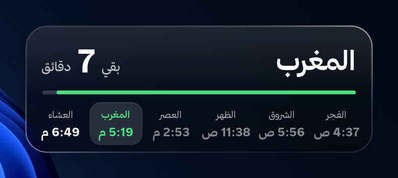
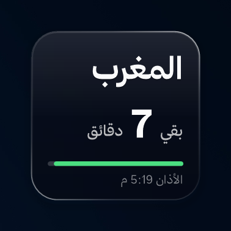
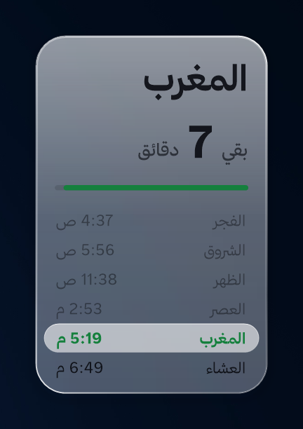
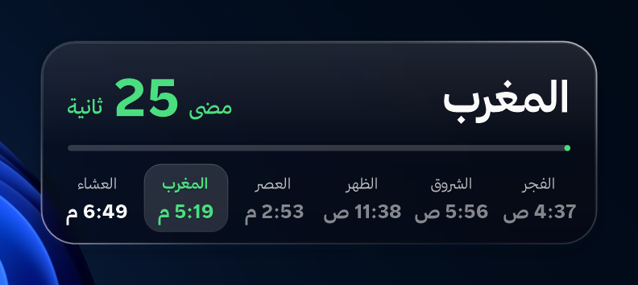

# مواقيت الصلاة — أداة سطح مكتب لويندوز

أداة زجاجية خفيفة جدًا على طريقة Liquid Glass من أبل، تجلس على سطح المكتب وتعرض الصلاة القادمة وكم باقي على أذانها، وكم مضى على الأذان بعد دخول الوقت.

  

  
  

## المميزات

- **خفيفة جدًا:** ما تستخدم كرت الشاشة أبدًا، واستهلاك المعالج تقريبًا صفر، والذاكرة حوالي ١٠ ميقا. ملف واحد بحجم ~٧٠ كيلوبايت وما يحتاج تثبيت.
- **بقي / مضى:** قبل الأذان تعرض "بقي 14 دقيقة"، وأول ما يدخل الوقت تتحول بالأخضر إلى "مضى 25 ثانية" ثم "مضى 12 دقيقة" لمدة نصف ساعة، وبعدها ترجع تعد للصلاة اللي بعدها.
- **ثلاثة أشكال:** مربع (الصلاة القادمة فقط)، أو مستطيل عرضي أو طولي مع كل صلوات اليوم.
- **تقويم أم القرى** محسوب على جهازك بدون إنترنت (العشاء ١٢٠ دقيقة في رمضان)، والعصر على المعتمد في السعودية.
- **تحجز مكانها على سطح المكتب:** أي اختصار يجي تحتها ينتقل لمكان فاضي، أو تقدر تخليها فوق الاختصارات بدون ما تحركها.
- **أكثر من شاشة:** على كل الشاشات ولكل شاشة مكانها، أو على شاشة وحدة بس.
- **زجاج حقيقي:** خلفية سطح المكتب مموّهة خلفها، وتتبع وضع ويندوز (فاتح/داكن) تلقائيًا.
- مدن السعودية والخليج ودول أخرى، أو إحداثيات مخصصة.

  

## التحميل والتشغيل

1. حمّل `PrayerWidget.exe` من صفحة [Releases](../../releases/latest).
2. شغّله، وتطلع الأداة في زاوية الشاشة.
3. اسحبها بالماوس لأي مكان، وكلك يمين عليها للإعدادات: المدينة، الشكل، الشاشات، المظهر، الحجم، التشغيل مع ويندوز، والخروج...

يحتاج ويندوز 10 أو 11 (‏.NET Framework 4.8 موجود فيها أصلًا).

> ويندوز SmartScreen ممكن يطلع تحذير لأن الملف غير موقّع رقميًا: اضغط "مزيد من المعلومات" ثم "تشغيل على أي حال".

## الخط

الأداة تستخدم **خط ثمانية** تلقائيًا إذا كان مثبّتًا على جهازك، وإلا تستخدم خط ويندوز. الخط غير مرفق مع البرنامج لأن شروطه تمنع إعادة توزيع ملفاته — تقدر تحمّله مجانًا من [موقع ثمانية الرسمي](https://ask.thmanyah.com/hc/en-001/articles/45993930027281-Thmanyah-Font-for-Everyone) وتثبّته، والأداة تلقاه بنفسها.

## البناء من الكود

ما يحتاج تثبيت أي شي: شغّل `build.bat` وهو يستخدم مترجم C# الموجود في ويندوز.

الكود كله في ملف واحد: [`PrayerWidget.cs`](PrayerWidget.cs) (WinForms + GDI+ مع نافذة طبقية `UpdateLayeredWindow`). الإعدادات تنحفظ في `%APPDATA%\PrayerWidget\settings.ini`.

## الترخيص

مفتوح المصدر بترخيص [MIT](LICENSE): استخدمه وعدّل عليه ووزّعه بحرية، بشرط تبقي إشعار الترخيص. (خط ثمانية له ترخيصه الخاص وغير مشمول.)

---

**Prayer Times widget for Windows** — a tiny Liquid-Glass-style desktop widget showing the next prayer and a live countdown (Umm al-Qura, computed offline). Single ~70 KB exe, no GPU use, near-zero CPU. Download it from [Releases](../../releases/latest), or build it with `build.bat` (uses the C# compiler that ships with Windows). Open source under the [MIT License](LICENSE).
